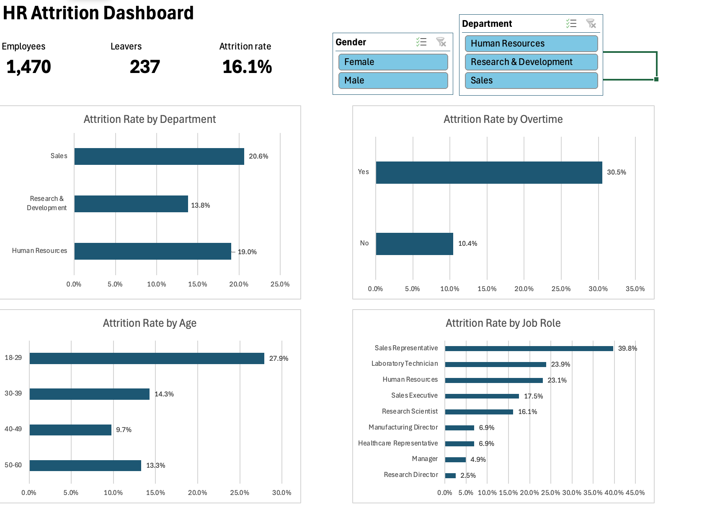

# HR Attrition Dashboard

An interactive Excel dashboard I built to help HR teams see **who is leaving, and where**, using IBM's HR Analytics dataset of 1,470 employees.

## The question

Since the  overall attrition rate is of 16.1% (237 out of 1,470 employees),we must consider which groups fall above that percentage and what they have in common.

## Key findings

- **Overtime is not always beneficial to the company.** Employees who work overtime leave at a rate of 30.5%, compared with 10.4% for those who don't. That is nearly three times higher.The company should consider promoting less overtime as it is only provides short term satisfaction. 
- **Younger staff are more likely to leave.** Employees aged 18–29 have an attrition rate of 27.9%, almost three times more than those aged 40–49 (9.7%).
- **Sales suffers the most losses.** The Sales department has the highest rate at 20.6%, and Sales Representatives have the highest rate of any role at 39.8%.
- **Senior roles rarely leave.** Managers (4.9%) and Research Directors (2.5%) have the lowest attrition rates in the company.

Looking at these together, attrition seems to be concentrated among younger, junior, staff, especially those working overtime. Noticiibly, when I filtered the dashboard to Sales only, the overtime gap became even wider (37.5% compared with 13.8%).

## How I built it

1. **Cleaning the data:** Firstly, I converted the data into an Excel Table and removed three columns that had the same value for every employee (EmployeeCount, Over18 and StandardHours). Since they never change, they cannot help explain why anyone leaves.
2. **Adding helper columns:** Then, I created a `Left` column (1 = left, 0 = stayed), which means its average gives the attrition rate directly. I also added `Age Band` and `Tenure Band` so employees could be grouped fairly.
3. **Analysing with PivotTables:** Afterwards, I calculated the attrition rate by department, overtime, age band and job role.
4. **Building the dashboard:** Finally, I added the key numbers, four sorted bar charts, and Department and Gender slicers that update every chart at once.

## Limitations

- The dataset is fictional, so the findings show the method rather than describe a real company.
- The results show correlation, not causation. Overtime is linked to people leaving, but I cannot prove it is the cause.
- Some groups are quite small (for example, only 63 people work in Human Resources), so a few leavers can shift their rate a lot.

## What I would add next

Since I did this as an oppertunity to learn Excel and it's features, I would like to further challenge myself by adding a tenure chart using the `Tenure Band` column. I would then be able to see whether new starters leave more than long-serving staff.

## Data source

[IBM HR Analytics Employee Attrition & Performance](https://www.kaggle.com/datasets/pavansubhasht/ibm-hr-analytics-attrition-dataset) by pavansubhash on Kaggle. It is a fictional dataset created by IBM data scientists, shared under the [Open Database License (ODbL) v1.0](https://opendatacommons.org/licenses/odbl/1-0/). Individual values are under the [Database Contents License (DbCL) v1.0](https://opendatacommons.org/licenses/dbcl/1-0/).